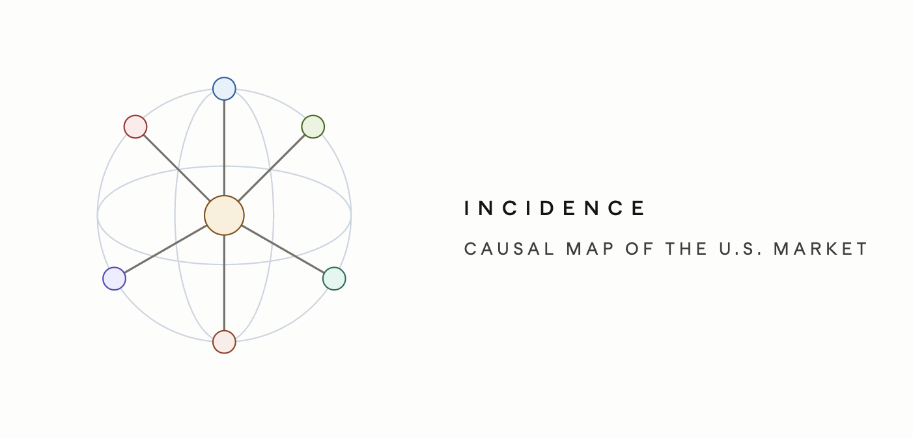
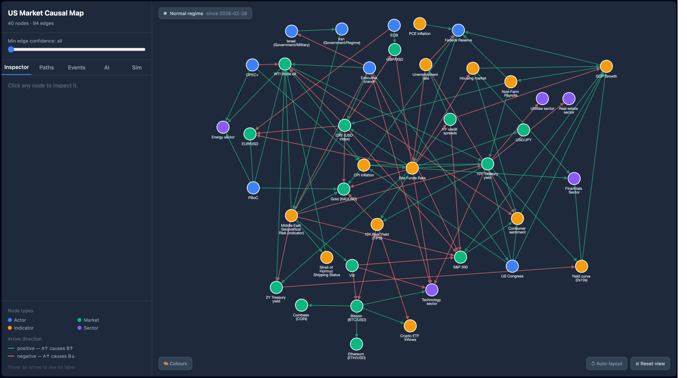
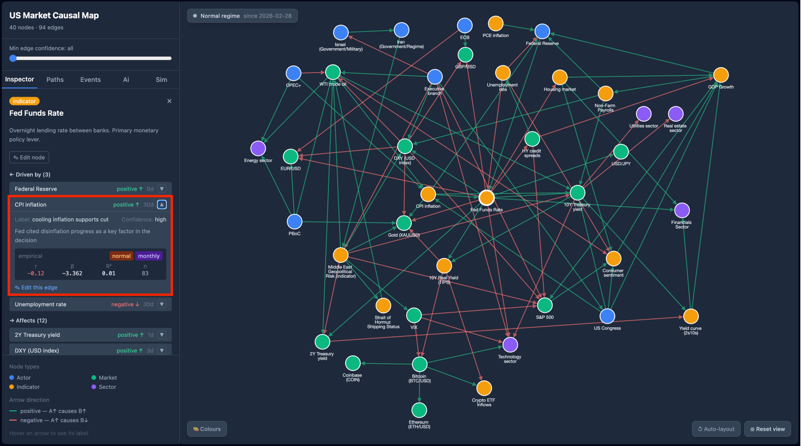
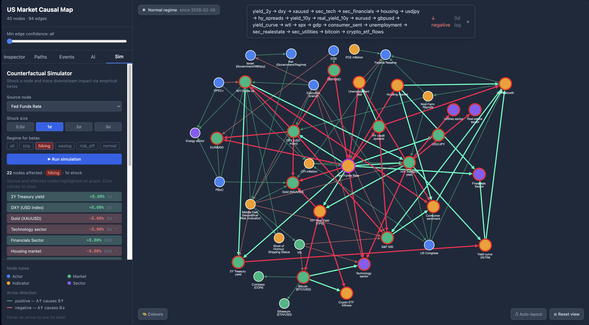
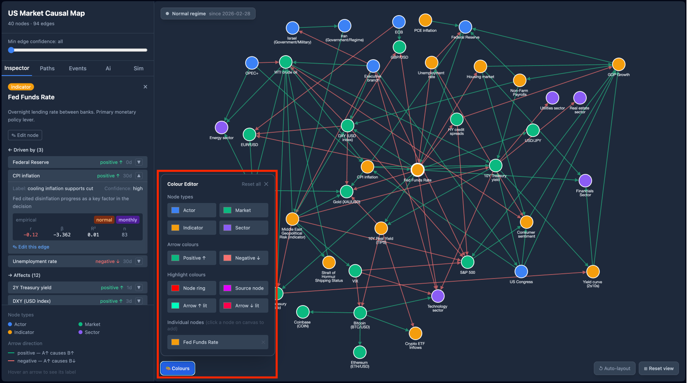

# INCIDENCE

A causal diagram tool for the US financial market — trace how shocks propagate
through actors, indicators, sectors, and markets using empirically derived
relationships, regime-aware analysis, and counterfactual simulation.





---

## What it does

INCIDENCE models the US financial system as a directed causal graph. Nodes
represent actors (the Fed, Congress), markets (S&P 500, gold, FX pairs),
indicators (CPI, yields, unemployment), and sectors (energy, financials,
tech). Edges represent causal relationships — direction, expected lag, and
confidence.

On top of the graph structure, every edge is enriched with **empirical
statistics** computed from 25 years of price and macro data: correlation,
beta, R², and observation count, at both daily and monthly frequency, and
sliced by **market regime** (ZIRP, hiking, easing, risk-off, normal).

This lets you:

- **Trace causal paths** between any two nodes, ranked by lag
- **Replay historical events** (rate decisions, geopolitical shocks, crypto
  selloffs) and see which nodes and edges were affected
- **Inspect the empirical strength** of any relationship — and how it changes
  across market regimes
- **Run counterfactual simulations** — shock a node by N standard deviations
  and watch the impact propagate through the graph via real betas
- **Ingest new events from news articles** using Claude, which proposes new
  nodes, edges, and event records that you review before committing

---

## Screenshots







---

## Architecture

```
causal-map/
  backend/
    data/
      nodes.json          37 nodes — actors, markets, indicators, sectors
      edges.json          83 edges — direction, lag, confidence, regimes
      events.json          historical events, growing via AI ingestion
      db.py                DuckDB connection + schema
      ingest.py            yfinance + FRED data ingestion
      market_data.duckdb   25 years of price + macro data
    graph/
      loader.py            JSON -> NetworkX DiGraph
      queries.py           paths, neighbours, events
      enrichment.py        correlation/beta/R^2, daily + monthly, per regime
      regimes.py           regime detection from FEDFUNDS + VIX
      regime_tagger.py     auto-tags edges with active regimes
      simulator.py         BFS counterfactual shock propagation
    api/
      main.py              FastAPI app, all endpoints
  frontend/
    src/
      api/client.js
      components/
        GraphCanvas.jsx    Cytoscape canvas, colour editor, regime badge
        NodeInspector.jsx  node detail, edge stats, edge editor
        PathFinder.jsx
        EventPanel.jsx
        AIIngestion.jsx
        Simulator.jsx
      App.jsx              5-tab sidebar
```

**Stack**: Python 3.11, FastAPI, NetworkX, DuckDB, pandas, yfinance, fredapi
on the backend; React (Vite), Cytoscape.js, TailwindCSS, Recharts on the
frontend.

---

## Getting started

### Prerequisites

- Python 3.11+
- Node.js 18+
- A free [FRED API key](https://fred.stlouisfed.org/docs/api/api_key.html)

### Setup

```bash
git clone https://github.com/<your-username>/incidence.git
cd incidence

# Backend
cd backend
python -m venv venv
source venv/bin/activate          # Windows: venv\Scripts\Activate.ps1
pip install fastapi uvicorn networkx duckdb pandas yfinance fredapi python-dotenv

echo "FRED_API_KEY=your_key_here" > .env

python -m data.db                  # create DB schema
python -m data.ingest               # pull 25 years of price + macro data
python -m graph.enrichment          # compute empirical stats (all regimes)
python -m graph.regime_tagger       # auto-tag edges with regime activity

cd ../frontend
npm install
```

### Running

From the project root, with one command:

```bash
./start.sh          # Mac / Linux
```

```powershell
.\start.ps1          # Windows
```

This starts the backend on `http://localhost:8000` and the frontend on
`http://localhost:5173` in a single terminal. **Ctrl+C stops both.**

On first run on Mac you may need to make the script executable:

```bash
chmod +x start.sh
```

<details>
<summary>Running manually in two terminals (for debugging)</summary>

```bash
# Terminal 1
cd backend && source venv/bin/activate && uvicorn api.main:app --reload

# Terminal 2
cd frontend && npm run dev
```

</details>

Open `http://localhost:5173`.

---

## Using the app

The interface is a graph canvas with a five-tab sidebar:

- **Inspector** — click any node to see its details, price chart, and all
  upstream/downstream edges. Expand an edge to see its empirical correlation,
  beta, R², and observation count, broken down by frequency and regime.
- **Paths** — find all causal paths between two nodes, ranked by total lag.
- **Events** — browse historical events; selecting one highlights the
  affected nodes and edges on the canvas, with price charts around the event
  date.
- **AI** — paste a news article into Claude using the exported graph context,
  then paste back Claude's proposed event/nodes/edges for review and commit.
- **Sim** — pick a source node and a shock size (in standard deviations), and
  see the estimated downstream impact ranked by magnitude, with the affected
  subgraph highlighted automatically.

A floating colour editor (bottom-left of the canvas) lets you customise node
type colours, individual node colours, arrow colours, and highlight colours —
all saved locally.

See [`UserGuide.md`](UserGuide.md) for the full walkthrough, including how
regimes are detected, what the empirical stats mean, and how to maintain the
graph over time.

---

## Maintaining the data

```bash
cd backend
python -m data.ingest         # refresh price + macro data
python -m graph.enrichment     # recompute all empirical stats
python -m graph.regime_tagger  # re-tag edges (preserves manual overrides)
```

Run these periodically to keep the empirical layer current. Enrichment runs
across daily/monthly frequency and all five regimes for all 83 edges, so it
takes a few minutes.

---

## Notes

This project was built iteratively, session by session, with the data model,
graph engine, API, frontend, empirical enrichment, regime detection,
counterfactual simulator, and UI customisation each developed as discrete
phases. See [`CLAUDE.md`](CLAUDE.md) for the full technical history and phase
breakdown.
